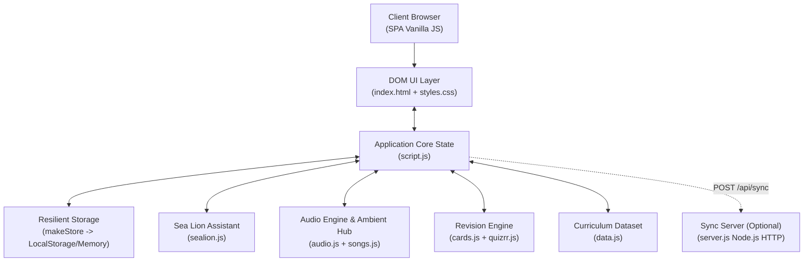

# System Architecture & Technical Design

This document details the architectural design and data flow of **Rectilinear Redundancies**.

---

## High-Level Architecture Overview

---

## 1. Client Core (`script.js`)

The core application operates as a reactive, zero-dependency single-page application:
- **Resilient Storage (`makeStore`)**: Dynamically verifies `localStorage` functionality. If the user is in private browsing, sandbox mode, or if local storage is blocked by security policies, it seamlessly falls back to an in-memory dictionary.
- **Pomodoro Cycle Engine**: Tracks active session intervals, short breaks, and long breaks with audio chime dispatch and streak calculations.
- **Burnout Mitigation**: Evaluates cumulative daily focus time against `S.burnoutHours` and prompts a "Touch Grass" reminder overlay when exceeded.

---

## 2. Sea Lion Virtual Companion (`sealion.js`)

Sea Lion provides an interactive, stateful companion on the UI:
- Dispatches context-aware quotes and study encouragement.
- Responds to interactive clicks, drag positioning, and conversation prompts.
- Hosts an administrative console unlocked via secret phrase triggers.

---

## 3. Audio & Lo-Fi Engine (`audio.js` & `songs.js`)

- **Synthesized Ambient Soundscapes**: Leverages the browser's native `AudioContext` to generate layered white noise, rain sounds, and frequency beats in pure code (no heavy external audio assets needed).
- **Study Beats & Popular Songs**: Integrates curated study stream endpoints registered in `songs.js`.

---

## 4. Cloud Synchronization (`server.js`)

- **Lightweight Synchronization**: The client periodically pushes sanitized study analytics (daily hours, streak, subject splits) to `/api/sync`.
- **Timing-Safe Authentication**: Protects admin endpoints (`/api/users`) using `crypto.timingSafeEqual` to eliminate side-channel timing attacks.
